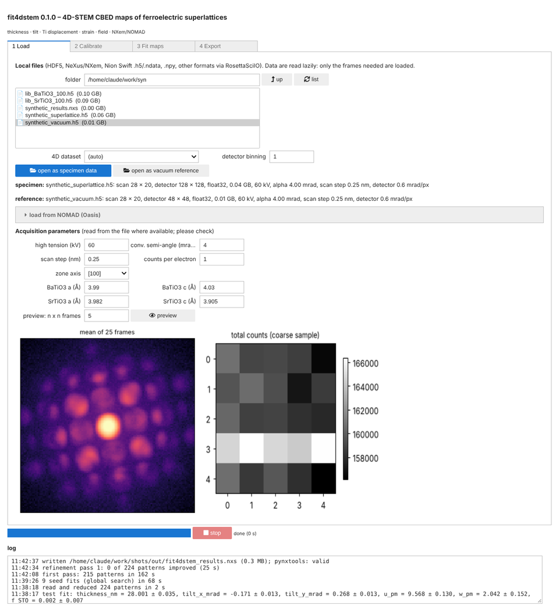
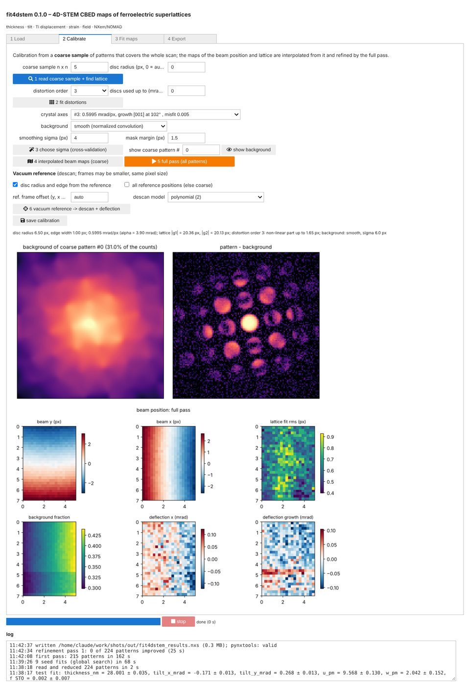
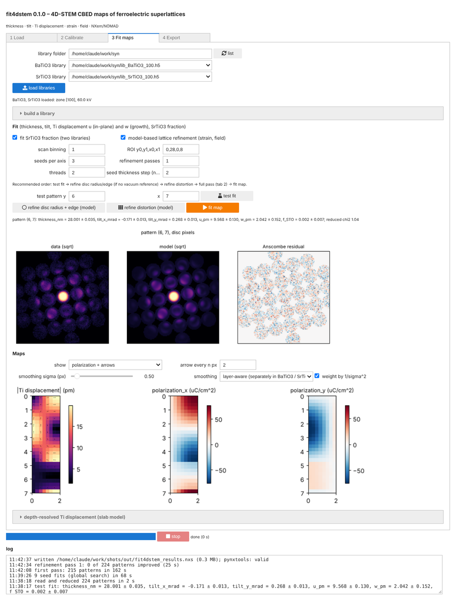
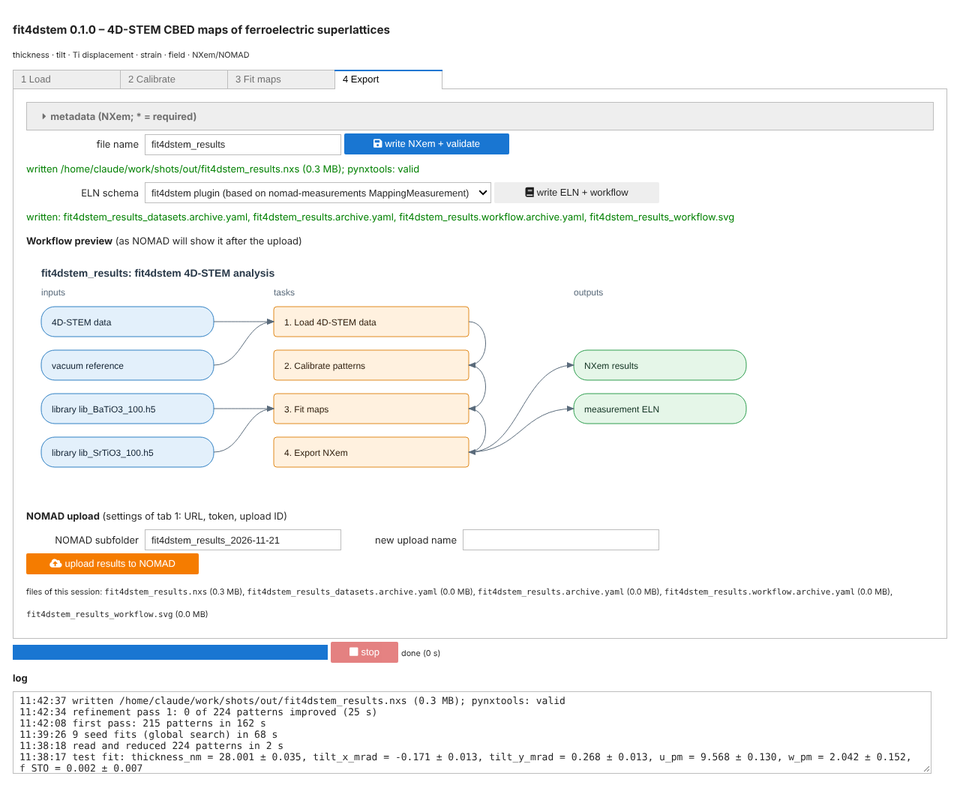
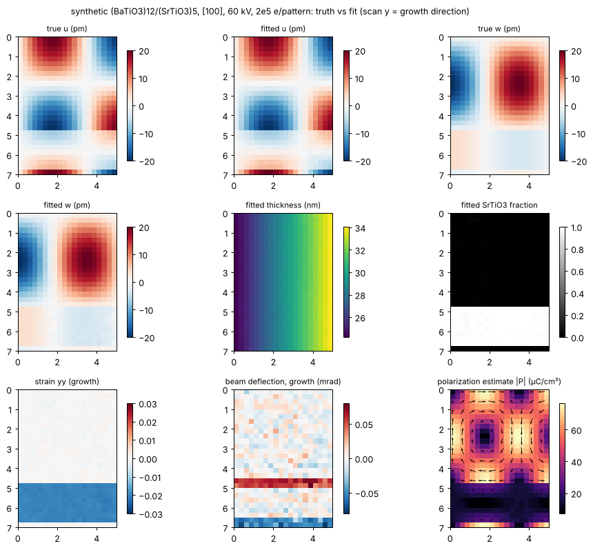

# fit4DSTEM — quantitative 4D-STEM (CBED) maps of ferroelectric superlattices

**fit4dstem** maps the **local thickness, crystal tilt, Ti displacement (polarization), BaTiO₃/SrTiO₃ phase,
strain and projected electric field** of perovskite superlattices pattern by pattern. It fits plane-wave multislice
rocking curves to non-overlapping CBED patterns of a 4D-STEM scan. It was written for (BaTiO₃)ₘ/(SrTiO₃)ₙ
superlattices with polar vortices, such as those of [Hevelke et al., *Nat. Commun.* 17, 9648 (2026)](https://doi.org/10.1038/s41467-026-77270-0),
mapped by diffraction at **60 kV** on a Nion HERMES instead of by HAADF imaging at 200 kV.

The tool is a widget app with four tabs. It runs in **Jupyter**, as a **Voilà** or **Solara** web app, and as a
**NOMAD dashboard**, with lazy loading from a NOMAD Oasis.

| tab | what it does |
|---|---|
| **1 Load** | Opens 4D-STEM data lazily: HDF5 (any layout), NeXus/**NXem**, **Nion Swift** (`.h5`, `.ndata`), `.npy`, and other formats via RosettaSciIO. Files in a **NOMAD** upload (production, test or any Oasis) are read with **HTTP range requests**, so only the frames that are needed are transferred from data sets of tens of GB. Also opens a **vacuum reference scan** (smaller frames allowed). |
| **2 Calibrate** | Works on a **coarse sample** of patterns that covers the whole scan. It finds the disc radius and edge, the lattice of the discs and the **polynomial distortions** (orders 2…N, e.g. from the energy filter, vanishing at the centre). It fits the **incoherent background** from the pixels between the discs (smoothing chosen by cross-validation) and assigns the crystal zone. It builds the **beam-position map**: interpolated from the coarse sample, then refined by a full pass over all patterns. From the **vacuum reference** it gets the descan and hence the **beam deflection** (projected field). |
| **3 Fit maps** | Fits thickness, tilt, Ti displacement (u in-plane, w along growth) and SrTiO₃ fraction for every pattern. Neighbouring patterns are used as starting points, and refinement passes escape local minima. A **model-based lattice refinement** gives strain and beam position. Maps can be **smoothed** (Gaussian, optionally **layer-aware** so that the sharp interfaces stay sharp). The tab also gives **strain** relative to the mean BaTiO₃ lattice, the **polarization** (Born effective charges), the **field**, and a **depth-resolved** (slab) Ti displacement. Rocking-curve libraries are built here. |
| **4 Export** | **NXem** (NeXus) file of all maps, validated with `pynxtools`. **NOMAD ELN** entry based on `MappingMeasurement` of [nomad-measurements](https://github.com/FAIRmat-NFDI/nomad-measurements). **Workflow** archive (`workflow2`: data + reference + libraries → load → calibrate → fit → export → NXem + ELN), with a **preview of the workflow graph**. Upload to NOMAD. |

| | |
|---|---|
|  |  |
| **1 Load**: local / NOMAD, lazy; acquisition parameters; preview | **2 Calibrate**: background, beam-position maps, deflection from the vacuum reference |
|  |  |
| **3 Fit maps**: test fit (data, model, residual) and maps with layer-aware smoothing | **4 Export**: NXem (validated), ELN + workflow with preview, NOMAD upload |

## Quick start

```bash
git clone https://github.com/christophys/fit4DSTEM && cd fit4DSTEM
pip install -e ".[web,nexus,notebooks]"

voila notebooks/fit4dstem_app.ipynb                 # Voilà app
solara run webapp/solara_app.py                     # stand-alone web app, http://localhost:8765
python examples/run_synthetic.py work               # end-to-end example on synthetic data (also a test)
pytest tests                                        # unit tests (~30 s)
nion2nxs /path/to/nion_export                       # Nion .npy+.json / .zip -> NXem .nxs (lossless, resumable)
```

In Python:

```python
from fit4dstem import io, calibration as calm, fitting as fm, multislice as ms, crystal as cr
ds  = io.open_dataset("scan.h5")                    # lazy (Nion / NXem / HDF5)
lib = ms.build_library(cr.MATERIALS["BaTiO3"], "[110]", 60e3, radius_mrad=7, path="lib_BTO_110.h5")
cal = calm.initial_calibration(ds.frames(io.coarse_positions(ds.scan_shape, 12)))
...                                                  # see examples/run_synthetic.py for the whole chain
```

**NOMAD plugin.** The package has two NOMAD entry points: the dashboard (`fit4dstem_nomad.dashboards`) and the
ELN schema (`fit4dstem_nomad.schema_packages`, which needs `nomad-measurements`). In a NOMAD distribution, add the
repository as a package (`uv add ./packages/fit4DSTEM[nomad]`). The app then appears under
`/nomad-oasis/dashboards/fit4dstem/` and uses the user's NOMAD login. Set `FIT4DSTEM_DASHBOARD_URL` to serve it
separately.

## Method in brief

* **Why non-overlapping CBED.** Each detector pixel inside disc *g* is reached by exactly one incident direction
  *k*, so the pattern is the set of rocking curves *I_g(k)* of plane waves. It does **not depend on the probe
  position, focus or aberrations**, which is checked numerically. Patterns of a homogeneous region can therefore
  be summed without loss, and a crystal tilt τ simply shifts the rocking curves inside the fixed discs.
* **Forward model.** A plane-wave multislice of the zone cell is computed for a grid of incident directions
  (`fit4dstem.multislice`). Slice potentials are evaluated analytically in Fourier space from the Peng
  5-Gaussian scattering factors, which is exact for any sub-pixel atom position. They include Debye–Waller
  factors and an optional absorptive potential. Propagation agrees with abTEM to 10⁻³ for the same potential.
  **Libraries** store *I_g(k; t, u, w)* for both materials. The Ti displacement (u, w) carries the O ions along
  in the P4mm soft-mode pattern (Kwei et al. 1993).
* **Fit.** Each pattern is fitted on its disc pixels only. The model includes the pixel's incident direction from
  the distortion-corrected lattice, the aperture edge, and the background from tab 2 with free scale. The
  objective is the Anscombe (Poisson) least squares; uncertainties come from the Jacobian.
* **Positions.** The lattice of the discs, and hence **strain**, **lattice rotation** and **beam position**, is
  refined with the fitted model. Unlike edge detection, this is not biased by the intensity inside the discs. The
  same disc-by-disc model positions give the **distortion** (tab 3, "refine distortion").
* **Field.** The deflection equals the beam position minus the descan from the vacuum reference. The projected
  field is ∫E dz = −θ·pv/e, and E is that divided by the local thickness.
* **Depth.** N slabs along the beam, each with its own (u, w), are fitted jointly to the patterns of a region with
  on-the-fly multislice. The sensitivity comes from dynamical scattering. The correlations between the slabs show
  what is actually determined.

## Validation (synthetic data, `examples/run_synthetic.py`)

The test data set is a [100] cross-section of a (BaTiO₃)₁₂/(SrTiO₃)₅ superlattice with a vortex-like
displacement field (±20 pm), a thickness wedge (24–34 nm), bending, descan, ±0.06 mrad field deflections at the
interfaces, a 2 % shorter c-axis in SrTiO₃, energy-filter-like distortions, background and Poisson noise
(2·10⁵ electrons per pattern). It is a 28 × 20 scan with 128² pixels at 0.6 mrad/px and α = 4 mrad, run on 2 CPU
cores.



| quantity | rms error vs. truth | Cramér–Rao σ (median) |
|---|---|---|
| thickness | 0.05 nm | 0.03 nm |
| tilt (x, y) | 0.02 mrad | 0.014 mrad |
| Ti displacement u, w | 0.19, 0.20 pm | 0.14, 0.15 pm |
| BaTiO₃/SrTiO₃ classification | 0 of 560 wrong | |
| strain ε_yy in SrTiO₃ (true −0.020) | −0.0199 ± 0.0005 (model-based lattice) | ±0.0037 with edge detection only |
| beam deflection (step ±0.06 mrad) | 0.012 mrad | 0.04 mrad with edge detection only |
| distortion (non-linear part, detector corners) | 0.2 px (model-based) | 1.4 px with edge detection only |

The NXem file passes `pynxtools` validation. The measurement ELN parses in NOMAD 2.0 with the plugin, and the
workflow archive loads as a valid `workflow2`. The map fit (neighbour seeding, model-based lattice refinement, one
refinement pass) takes about 1.2 s per pattern on one core; multithreading and scan binning are available.

## Practical settings (60 kV)

From the CBED information study that led to this tool:

* **Convergence semi-angle:** α ≈ 4 mrad. It must stay below half the 100 disc spacing (6.1 mrad).
* **Detector:** an electron-counting detector with ≈ 0.6–1.2 mrad per pixel.
* **Recorded angle:** at least ±60–75 mrad.
* **Dose:** sum patterns of homogeneous regions to about 10⁶ electrons.

Libraries for the [110] zone (g ≤ 1.2 Å⁻¹, directions to 7 mrad, 7 × 7 displacements, up to 50 nm) take
about 30 min per material on a laptop and need about 0.5 GB.

## Limitations

* **Thermal diffuse scattering (TDS)** enters only as Debye–Waller damping, an absorptive potential and the
  fitted background. TDS inside the discs is not modelled.
* **Interface columns** of mixed composition are approximated as an incoherent mixture of the two libraries.
* The **absolute** Ti displacement is limited by the potential model to about 1 pm, while relative changes are
  more precise.
* **Depth profiles** are only weakly determined: the slab displacements are about an order of magnitude less
  precise than the mean.
* The **field map** is a projection along the beam.

## Repository layout

```
fit4dstem/        package: io (lazy readers, NOMAD range reads), calibration, multislice (engine, libraries),
                  fitting (pattern + map fits), strain, reference (descan, field), depth, nxem, eln, app, plots,
                  convert (Nion export -> NXem, CLI nion2nxs)
fit4dstem_nomad/  NOMAD plugin: dashboard (Solara) and ELN schema (ELNFourDSTEMMeasurement)
webapp/           stand-alone Solara app
notebooks/        fit4dstem_app.ipynb (Jupyter / Voilà), 00_download_github_repo.ipynb
examples/         run_synthetic.py (end-to-end example)
tests/            pytest suite
docs/             figures
```

## License

BSD 3-Clause License, © 2026 Christoph T. Koch. See [LICENSE](LICENSE).
